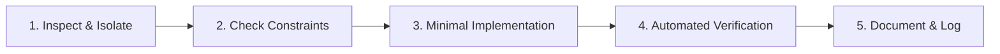

# Change Policy & Strict Preservation Rules

> **Purpose:** Protect existing capabilities, prevent regressions, and enforce safe AI modification protocols.  
> **Target Audience:** All AI coding assistants, agents, and human contributors working on Tekken 8 Movepedia.

---

## 1. Absolute Preservation Rules (Default Invariant)

1. **Default Protected State:**
   - Every existing feature, route, API endpoint, database table, UI view, and user workflow is **STRICTLY PROTECTED** by default.
   - Do NOT modify, disable, or delete any unrequested functionality.
2. **Minimal Change Scope:**
   - Modify **ONLY** what the user explicitly requests and the absolute minimum supporting code necessary to accomplish the task.
   - Do NOT introduce unrequested "cleanup" refactors, opinionated formatting changes, or speculative features.
3. **No Silent Destruction:**
   - When refining or improving UI/UX (e.g. styling buttons, tightening card padding, updating colors), ensure that underlying click handlers, data attributes, event listeners, and data fields are preserved 100%. Never trade functionality for aesthetics.
4. **Modify Over Duplicate:**
   - Always prefer modifying and enhancing existing components in `style.css` or `app.js` over creating duplicate, parallel, or competing implementations.
5. **Architectural Permanence:**
   - Do NOT replace the framework (FastAPI), presentation tier (Vanilla HTML/CSS/ES6 JS), database engine (SQLite 3 / SQLAlchemy 2.0), or routing strategy without explicit user authorization.

---

## 2. Allowed vs. Prohibited Actions

| Category | Allowed Actions ✅ | Prohibited Actions ❌ |
|---|---|---|
| **Frontend & UI** | - Adjusting CSS variables (`--btn-h-nav`, `--radius-sm`) - Refining padding, fonts, and responsiveness - Enhancing existing cards or table readability - Adding requested modal views or buttons | - Replacing Vanilla JS with React, Vue, or Svelte - Injecting bulky CSS frameworks (Tailwind, Bootstrap) - Removing data columns from tables - Deleting event listeners or action buttons |
| **Backend & APIs** | - Adding new requested endpoints under `/api/v1/` - Extending Pydantic schemas with optional fields - Enhancing calculation algorithms in `services/` - Adding new unit/integration tests | - Changing existing API route signatures or verbs - Removing fields from existing response schemas - Introducing unpinned, heavy external libraries - Bypassing Pydantic validation contracts |
| **Database & Models** | - Adding new tables or nullable columns - Creating non-destructive migration scripts - Seeding additional verified records | - Executing `DROP TABLE`, `TRUNCATE`, or destructive alters - Renaming existing database columns - Changing primary keys or established foreign key constraints - Deleting user or seed records |
| **Testing & Quality** | - Adding new test cases in `backend/tests/` - Running pytest and reporting actual executed output | - Fabricating test pass counts - Deleting existing tests to fake a green suite - Modifying test assertions to bypass failures |
| **Documentation** | - Merging new facts into existing docs - Updating worklogs and test counts - Adding diagrams and cross-references | - Overwriting existing documentation blindly - Exposing API keys, passwords, or secrets - Documenting unverified assumptions as facts |

---

## 3. Safe Modification Workflow

When tasked with modifying or adding code to this project, follow this 5-step sequence:

1. **Step 1: Inspect & Isolate:**
   - Inspect existing implementation in `app.js`, `style.css`, or backend services before writing any code.
   - If a user request conflicts with existing behavior, explain the trade-off clearly to the user before making destructive changes.
2. **Step 2: Check Constraints:**
   - Verify design tokens in [DESIGN_SYSTEM.md](DESIGN_SYSTEM.md) and database schemas in [DATA_AND_INTEGRATIONS.md](DATA_AND_INTEGRATIONS.md).
3. **Step 3: Minimal Implementation:**
   - Apply edits directly to target files. Keep edits clean, contiguous, and surgical.
4. **Step 4: Automated Verification:**
   - Execute the test suite via `.\.venv\Scripts\pytest backend/tests`.
   - Verify syntax of modified JavaScript via `node -c <file>`.
   - Only declare tests passed if they actually completed with exit code 0.
5. **Step 5: Document & Log:**
   - Update [docs/WORKLOG.md](WORKLOG.md) with concise bullet points of what was changed and verified.
