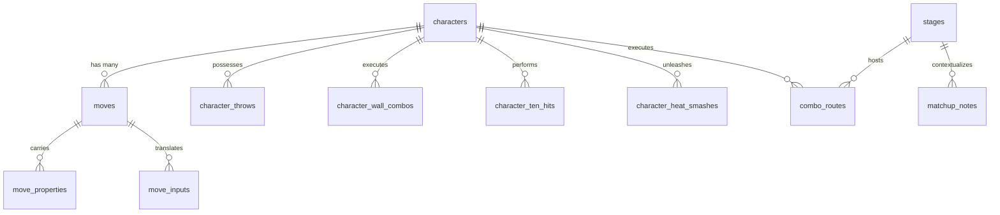
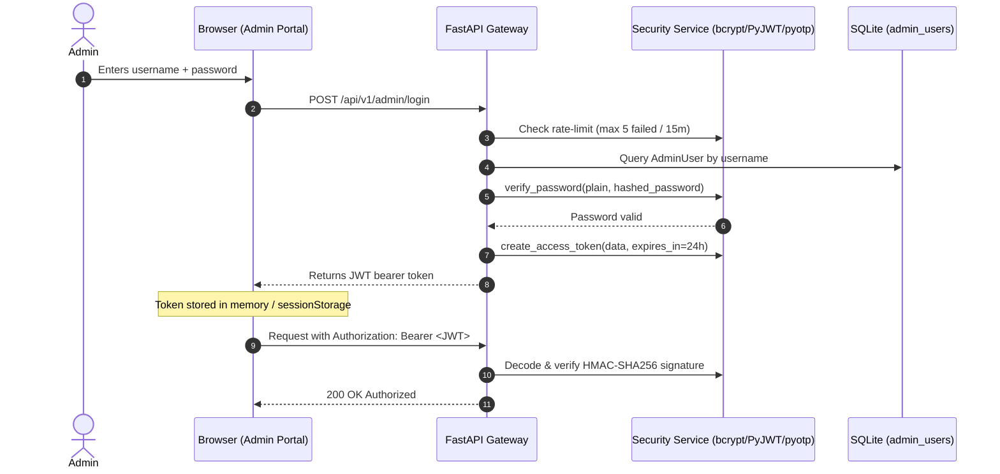

# Data Architecture, Schemas & API Integrations

> **Persistence Engine:** SQLite 3 (`tekken8_fyp.db`) via SQLAlchemy 2.0 ORM  
> **Security Protocol:** Salted bcrypt (12 rounds) + HMAC-SHA256 JWT + RFC 6238 TOTP 2FA  
> **API Specification:** OpenAPI 3.1 / Swagger (`/docs`) & ReDoc (`/redoc`)

---

## 1. Database Schema & Entity Relationships

The relational database consists of 17 core tables managed by declarative SQLAlchemy models:

### Table Definitions & Primary Columns

| Table Name | Count | Key Fields | Purpose |
|---|---|---|---|
| `characters` | 43 | `id`, `slug`, `name`, `archetype`, `is_dlc`, `avatar`, `hurtbox_class` | Full roster metadata and physical hurtbox classifications. |
| `moves` | 1,203 | `id`, `character_id`, `name`, `input`, `startup`, `block`, `hit`, `ch`, `damage`, `level` | Primary frame data library. Frame columns support numeric and text states (`N/A`, `KND`). |
| `move_properties` | 1,019 | `id`, `move_id`, `property_type`, `property_value` | Combat flags: `power_crush`, `heat_engager`, `homing`, `tornado`, `tailspin`. |
| `character_throws` | 397 | `id`, `character_id`, `throw_name`, `command_input`, `startup_frames`, `break_input`, `break_window`, `hand_cue` | Complete throw library (Generic, Command, Side, Back) with break inputs (`1`, `2`, `1+2`). |
| `character_wall_combos`| 129 | `id`, `character_id`, `category`, `notation`, `damage`, `difficulty`, `notes` | Optimal wall enders (Standard, Micro-Dash, Maximum Damage). |
| `character_ten_hits` | 43 | `id`, `character_id`, `notation`, `duck_point_frame`, `interrupt_point`, `damage` | 10-hit string counters with exact frames to duck or low parry. |
| `character_heat_smashes`| 43 | `id`, `character_id`, `category`, `startup_frames`, `damage`, `block_frame`, `tactical_counter` | Heat smashes categorized: i10-i14 Punish, Low, Long-Range, Stance Plus. |
| `stages` | 18 | `id`, `slug`, `name`, `shape`, `width_m`, `length_m`, `area_sqm`, `wall_distance`, `has_wall_break`, `has_floor_break`, `has_balcony_break` | Stage boundaries, centimeter spatial telemetry, and environmental hazard properties. |
| `combo_routes` | 89 | `id`, `character_id`, `stage_id`, `title`, `notation`, `damage`, `hits`, `combo_type`, `difficulty` | Master verified combos with juggle scaling and carry distance. |
| `combo_compatibilities`| 12 | `id`, `combo_route_id`, `target_hurtbox_class`, `is_compatible`, `notes` | Hurtbox-specific juggle consistency quirks (Bears, Bigs, Females). |
| `admin_users` | 1 | `id`, `username`, `email`, `hashed_password`, `totp_secret`, `is_active`, `is_superuser` | Cryptographically protected administrator identities. |
| `matchup_notes` | 5 | `id`, `character_id`, `opponent_character_id`, `stage_id`, `notes`, `rating` | Community and lab tactical notes for specific matchups. |
| `practice_records` | 2 | `id`, `user_id`, `session_token`, `success_count`, `reaction_time_ms` | Smart punishment reaction drill logs. |

---

## 2. API Endpoints Catalog

Base path: `/api/v1` (with secondary `/v1` alias mounted for serverless rewrite resilience).

| HTTP Method | Route Endpoint | Controller Function | Description |
|---|---|---|---|
| `GET` | `/health` | `health_check()` | Verifies API runtime and SQLite database connection status. |
| `GET` | `/characters` | `list_characters()` | Returns all 43 fighters (supports sorting, archetype, and DLC filters). |
| `GET` | `/characters/{slug}` | `get_character()` | Returns single fighter record with associated moves and stats. |
| `GET` | `/moves` | `list_moves()` | Filterable frame data search (character, startup, hit level, properties). |
| `GET` | `/combos` | `list_combos()` | Combos filtered by character, stage, difficulty, and combo type. |
| `POST`| `/combos/scaling/calculate` | `calculate_combo_scaling()` | Simulates Tekken 8 damage degradation across arbitrary input move chains. |
| `GET` | `/stages` | `list_stages()` | Returns all 18 battlegrounds with centimeter dimensions and hazards. |
| `POST`| `/matchup/analyze` | `analyze_matchup()` | Dual-perspective P1 vs P2 sidestep advice, whiff punishes, and counters. |
| `GET` | `/punishment/recommendations` | `get_punishments()` | Frame-perfect block punishment table (i10 to i15+ standing and WS). |
| `POST`| `/punishment/practice/record`| `record_practice_attempt()`| Records punishment drill reaction times and accuracy. |
| `POST`| `/notation/convert` | `convert_notation()` | Converts input string to 4 visualization modes (Arrows, English, Numpad, Controller). |
| `POST`| `/admin/login` | `admin_login()` | Authenticates SuperAdmin and returns signed JWT access token. |
| `GET` | `/admin/me` | `get_current_admin()` | Returns authenticated administrator session profile. |
| `POST`| `/admin/2fa/generate` | `generate_2fa_qr()` | Generates TOTP secret and data-URI QR code for Google Authenticator. |
| `POST`| `/admin/2fa/verify` | `verify_2fa_code()` | Validates 6-digit TOTP code before granting privileged operations. |
| `GET` | `/admin/audit-log` | `get_audit_log()` | Returns non-destructive event log of database mutations. |

---

## 3. Authentication & Cryptography Pipeline

---

## 4. Serverless File System & Writable Storage Flow

On Vercel and AWS Lambda, the root deployment directory (`/var/task`) is mounted strictly as **read-only**.

To prevent SQLite `attempt to write a readonly database` crashes:
1. `backend/app/database/session.py` detects `os.environ.get("VERCEL")`.
2. It locates `tekken8_fyp.db` in `/var/task` and checks if `/tmp/tekken8_fyp.db` exists.
3. If not, it executes `shutil.copyfile(src, "/tmp/tekken8_fyp.db")`.
4. SQLAlchemy connects to `sqlite:////tmp/tekken8_fyp.db`, granting full read/write access to temporary storage for connection journals, PRAGMA statements, and user practice sessions.
