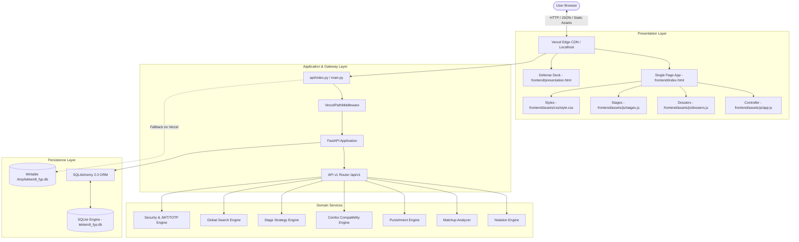

# System Architecture & Technical Design

> **Architecture:** Decoupled Client-Server SPA (FastAPI + Vanilla ES6 + SQLite)  
> **Target Version:** Tekken 8 Season 2 Standard (`v3.00.02`)  
> **Related Documents:** [PROJECT_CONTEXT.md](PROJECT_CONTEXT.md) | [DATA_AND_INTEGRATIONS.md](DATA_AND_INTEGRATIONS.md)

---

## 1. High-Level Architectural Diagram



---

## 2. Directory Layout & File Roles

```
tekken 8/
├── api/
│   └── index.py               # Vercel serverless function entrypoint exporting ASGI 'app'
├── backend/
│   ├── app/
│   │   ├── api/v1/
│   │   │   ├── endpoints/     # HTTP route controllers (characters, moves, combos, stages, etc.)
│   │   │   └── api.py         # Consolidated API v1 APIRouter
│   │   ├── core/              # Configuration (Pydantic BaseSettings), security, and custom errors
│   │   ├── database/          # SQLAlchemy session maker, engine, and init_db seeder
│   │   ├── models/            # 17 SQLAlchemy declarative models (Character, Move, Stage, etc.)
│   │   ├── schemas/           # Pydantic v2 request/response validation schemas
│   │   ├── services/          # Pure business logic engines (Notation, Matchup, Combo, Stage)
│   │   └── main.py            # Primary FastAPI app, CORS, lifespan, static file mounts
│   └── tests/                 # 18 automated pytest files (148 tests passing)
├── frontend/
│   ├── index.html             # Movepedia SPA interface (all 4 views)
│   ├── presentation.html      # 10-slide academic defense presentation deck
│   └── assets/
│       ├── css/style.css      # Design tokens, button system, fighter cards, and responsive rules
│       ├── js/
│       │   ├── app.js         # Reactive client controller, state management, and API calls
│       │   ├── dossiers.js    # Character biography and competitive strategy data
│       │   └── stages.js      # Centimeter stage dimensions and vector blueprint definitions
│       ├── avatars/           # 86 local character portraits and brand renders
│       ├── img/               # Stage backdrops, logos, and illustration assets
│       └── icons/             # Controller layout buttons and directional SVG icons
├── data/
│   ├── knowledge/             # Master compendium knowledge base (master_compendium.json)
│   ├── fixtures/              # Seed fixtures (sample_moves.json, etc.)
│   ├── raw/                   # Preserved upstream source responses
│   └── reports/               # Quality audit and completeness reports
├── docs/                      # Standardized AI development documentation
├── scripts/                   # Database seeders, verification scripts, and utilities
├── main.py                    # Root entrypoint for uvicorn and buildpacks
├── app.py                     # Root entrypoint alias
├── vercel.json                # Vercel v2 builds, routes, and includeFiles spec
├── pytest.ini                 # Pytest root configuration (pythonpath = .)
└── requirements.txt           # Python dependencies
```

---

## 3. Component Code Ownership & Responsibilities

| File / Component | Owner Responsibility | What You MUST NOT Put Here |
|---|---|---|
| `backend/app/main.py` | FastAPI app creation, CORS, exception handlers, static mounts, and fallback routing | Database schema definitions, heavy business algorithms |
| `backend/app/api/v1/endpoints/*.py` | HTTP request parsing, status codes, schema validation, dependency injection | Raw SQL queries, multi-step business logic (delegate to services) |
| `backend/app/services/*.py` | Algorithmic logic (frame calculations, damage degradation, notation parsing) | HTTP request/response objects, database session lifecycle |
| `backend/app/models/*.py` | SQLAlchemy database schema declarations and relationships | Direct request validation, presentation formatting |
| `backend/app/schemas/*.py` | Pydantic v2 input/output schemas | Database connection logic, UI markup |
| `frontend/assets/js/app.js` | UI rendering, view switching, DOM event handling, API fetching | Raw hardcoded frame data (must fetch from API/JSON) |
| `frontend/assets/js/dossiers.js`| Static character background lore, playstyles, and tier placements | Global DOM manipulation, network calls |
| `frontend/assets/js/stages.js`  | Stage spatial telemetry, polygon coordinates, and SVG definitions | Fighter frame data, authentication state |
| `frontend/assets/css/style.css` | Design tokens, button hierarchies, responsive breakpoints, animations | Inline styles, component business state |

---

## 4. Vercel Serverless Adaptation

To guarantee 100% reliable execution on Vercel's read-only serverless architecture:
1. **Entrypoint:** `api/index.py` adds project root to `sys.path` and exports `app` from `backend.app.main`.
2. **Writable Database Copy:** On cold start, `backend/app/database/session.py` detects `VERCEL=1`, copies `tekken8_fyp.db` from `/var/task` to `/tmp/tekken8_fyp.db` (the only writable directory), and binds SQLAlchemy to `/tmp`.
3. **Safe Lifespan:** `lifespan` in `main.py` wraps `init_db(db)` in try/except so database locks never trigger `500 FUNCTION_INVOCATION_FAILED`.
4. **VercelPathMiddleware:** Normalizes incoming paths and strips `/api/index.py` prefixes.
5. **Catch-All Frontend Route:** `@app.get("/{full_path:path}")` ensures non-API requests always serve the correct asset with proper MIME types or fallback to `index.html`.
