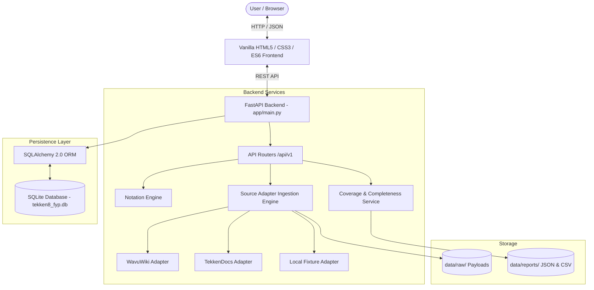
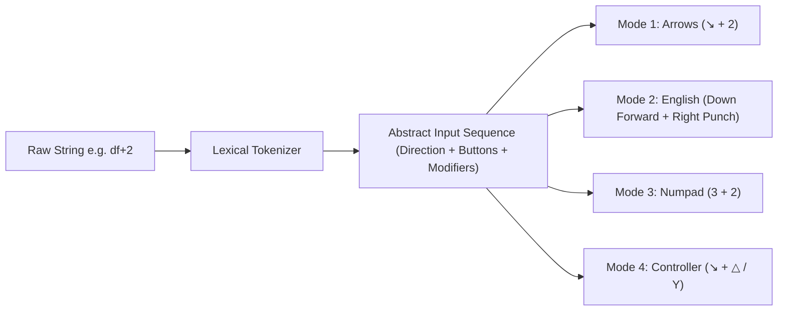

# System Architecture & Technical Design

**Project Title:** Tekken 8 Frame Data, Move Reference, Notation Visualization and Training Assistant Website  
**Academic Degree:** Computer Science Final Year Project (FYP)  
**System Architecture:** Modular Client-Server Architecture (REST API + Decoupled Vanilla Frontend)  

---

## 1. System Context & Overview

The application is structured into four cohesive layers:
1. **Presentation Layer (Frontend):** High-performance, zero-framework HTML5, CSS3, and vanilla ES6 JavaScript client offering a cyber-metallic Tekken 8 fighting game user experience with instant notation visualizers.
2. **Application & Service Layer (Backend):** Asynchronous Python FastAPI application exposing type-safe RESTful API endpoints with automated OpenAPI (Swagger) documentation.
3. **Domain & Data Normalization Layer:**
   - **Notation Engine:** Modular tokenizer and converter supporting 9 directional states, attack button mappings, simultaneous inputs, holds, and 4 display projections.
   - **Source Adapters:** Modular ingestion interfaces enforcing rate limiting, source attribution, and raw payload caching.
   - **Completeness & Coverage Analyzer:** Audits field completeness, conflicting values, and unknown frame values.
4. **Persistence Layer (Database):** SQLite 3 with SQLAlchemy 2.0 ORM, engineered with standard SQL types and strict foreign keys to preserve immediate compatibility with PostgreSQL.

---

## 2. Technology Stack & Justification

| Technology | Role | Justification |
|---|---|---|
| **Python 3.12** | Core Backend Language | Modern typing, high performance, robust data processing and scientific ecosystem. |
| **FastAPI** | REST API Framework | Native ASGI async performance, automatic OpenAPI/Swagger generation, Pydantic integration, and lightweight footprint without unnecessary dependencies. |
| **SQLAlchemy 2.0** | ORM & Relational Mapping | Standard declarative mapping, transactional integrity, index control, and database independence (SQLite to PostgreSQL). |
| **Pydantic v2** | Data Validation & Schemas | High-speed C-based JSON serialization, strict type checking, and boundary validation for untrusted external source data. |
| **SQLite 3** | Persistence Storage | Serverless, zero-configuration local database perfectly suited for embedded testing and repeatable academic demonstrations. |
| **Vanilla HTML5/CSS3/JS** | Presentation Layer | Maximum longevity, zero build-step overhead, instant load times, clean modular architecture, and precise visual control. |
| **pytest & HTTPX** | Automated Testing | Comprehensive unit and API integration testing with async client support. |

---

## 3. Modular Source Adapter Interface

The data-fetching foundation relies on a strict abstract adapter pattern (`backend/app/services/adapters/base.py`):

1. **Source Identification:** Each adapter declares its unique canonical identifier, approval status, rate limit policy, and supported endpoints.
2. **Raw Payload Preservation:** Whenever remote data is fetched, the unmodified JSON payload is archived to `data/raw/<source_id>_<timestamp>.json` to ensure verifiable data provenance.
3. **Structured Error Handling:** Network timeouts, parsing failures, and rate limit errors are caught and surfaced via structured batch status objects (`ImportBatch`) rather than crashing the ingestion pipeline.
4. **Idempotent Ingestion:** Duplicate records are detected and handled via unique composite keys `(character_id, normalized_notation)`, updating attributes if newer patch versions exist or recording a `DataConflict` if measurements contradict.

---

## 4. Notation Engine Architecture

Tekken input notation presents unique challenges due to simultaneous buttons (`1+2`), sequential strings (`1, 2, f+4`), directional inputs (`df`, `u/f`, `qcf`), hold states (`F`, `D`), and stance transitions (`ZEN`, `DVK`).

### Supported 9 Directions:
- Up: `↑` (`u`)
- Up Back: `↖` (`ub`)
- Up Forward: `↗` (`uf`)
- Back: `←` (`b`)
- Neutral: `•` (`n`)
- Forward: `→` (`f`)
- Down Back: `↙` (`db`)
- Down: `↓` (`d`)
- Down Forward: `↘` (`df`)

### Attack Button Semantics:
- `1` = Left Punch (LP) (PlayStation: `□`, Xbox: `X`)
- `2` = Right Punch (RP) (PlayStation: `△`, Xbox: `Y`)
- `3` = Left Kick (LK) (PlayStation: `✕`, Xbox: `A`)
- `4` = Right Kick (RK) (PlayStation: `○`, Xbox: `B`)

---

## 5. Security, Rate Limiting & Ethical Guidelines

1. **Safe Retry and Exponential Backoff:** The client adapter implements a token bucket throttle (minimum 1 second between requests) with exponential backoff on HTTP 429/503.
2. **Environment-Based Secrets:** No API keys, passwords, or credentials are hardcoded. All settings load from `.env` via `pydantic-settings`.
3. **Attribution & Transparency:** The UI permanently displays source attribution for `wavu.wiki`, `tekkendocs.com`, and `rbnorway.org` in compliance with community terms.
