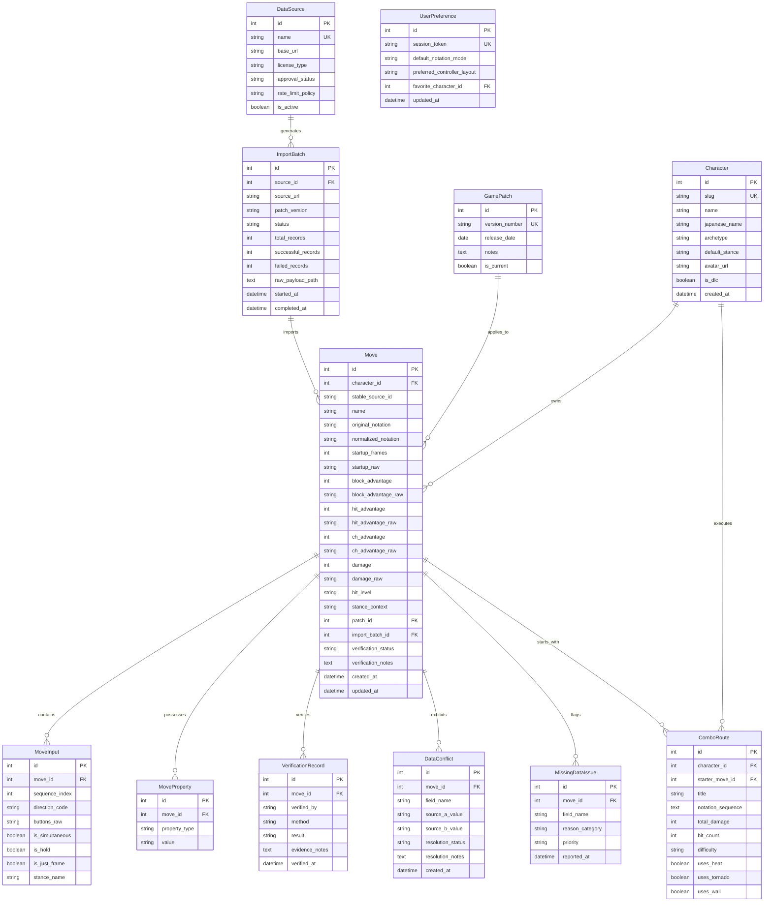

# Data Dictionary & Entity-Relationship Specification

**Project Title:** Tekken 8 Frame Data, Move Reference, Notation Visualization and Training Assistant  
**Database Engine:** SQLite 3 (Standard SQL-compliant for seamless PostgreSQL migration)  
**ORM Layer:** SQLAlchemy 2.0+  
**Document Revision:** 1.0 (Phase 1)  

---

## 1. Architectural Principles

1. **Explicit Nullability Over False Zeros:**
   Frame data advantage values (block, hit, counter-hit) can be positive, negative, or zero (e.g., `±0`). A move that is neutral on block is mathematically `0`. If a move's block advantage is unknown or unrecorded by the source, the column **MUST be NULL**, never stored as `0`.
2. **Provenance & Gameplay Property Separation:**
   Core gameplay mechanics (damage, startup, block advantage) are decoupled from source provenance metadata (batch ID, source URL, raw payload reference, verification timestamp) to allow multi-source ingestion and conflict detection.
3. **Status Taxonomy for Data Quality:**
   Data completeness flags distinguish between:
   - `VERIFIED`: Confirmed by lab testing or consensus across approved sources.
   - `UNVERIFIED`: Raw import without multi-source confirmation.
   - `CONFLICTING`: Divergent values reported by two or more sources.
   - `MISSING`: Field expected for this move category but absent.
   - `NOT_PROVIDED`: Field intentionally not captured or exposed by the upstream source.
   - `NOT_APPLICABLE`: Property does not apply to this move type (e.g., block advantage for unblockables or generic stances).
   - `UNKNOWN`: Frame property currently undetermined or variable.

---

## 2. Entity Relational Diagram (Mermaid)

---

## 3. Entity Data Dictionary

### 3.1 `characters`
Represents playable fighters in Tekken 8.

| Column | Type | Constraints | Description |
|---|---|---|---|
| `id` | INTEGER | PK, Auto-increment | Unique internal identifier |
| `slug` | VARCHAR(64) | NOT NULL, UNIQUE, INDEX | URL-safe identifier (e.g. `jin`, `kazuya`, `reina`) |
| `name` | VARCHAR(128) | NOT NULL | Canonical English display name |
| `japanese_name` | VARCHAR(128) | NULL | Official Japanese kanji/katakana name |
| `archetype` | VARCHAR(64) | NULL | Fighting style archetype (e.g., Mishima, Grappler, Rushdown) |
| `default_stance` | VARCHAR(64) | NULL | Neutral stance identifier |
| `avatar_url` | VARCHAR(255) | NULL | Local relative or static asset path for character render |
| `is_dlc` | BOOLEAN | NOT NULL, DEFAULT 0 | Flag indicating base roster vs DLC fighter |
| `created_at` | DATETIME | NOT NULL, DEFAULT UTC | Creation timestamp |

### 3.2 `moves`
Represents an individual technique, attack, throw, or stance transition.

| Column | Type | Constraints | Description |
|---|---|---|---|
| `id` | INTEGER | PK, Auto-increment | Internal unique primary key |
| `character_id` | INTEGER | NOT NULL, FK(`characters.id`), INDEX | Associated fighter ID |
| `stable_source_id` | VARCHAR(128) | NULL, INDEX | Upstream stable unique move ID |
| `name` | VARCHAR(128) | NULL | Move name (e.g., "Demon Scissors", "Electric Wind God Fist") |
| `original_notation` | VARCHAR(128) | NOT NULL, INDEX | Raw string notation from source (e.g. `f,n,d,df+2`) |
| `normalized_notation`| VARCHAR(128) | NOT NULL, INDEX | Canonical standardized notation sequence |
| `startup_frames` | INTEGER | NULL | Integer startup frame number (e.g., `14` for `i14`). NULL if variable/unknown. |
| `startup_raw` | VARCHAR(32) | NULL | Raw text including ranges (e.g., `i14~15`) |
| `block_advantage` | INTEGER | NULL | Frame advantage on block (e.g., `-10`, `+4`, `0`). NULL if unknown. |
| `block_advantage_raw`| VARCHAR(32) | NULL | Raw text representation (e.g. `+12cg`, `-14~-13`) |
| `hit_advantage` | INTEGER | NULL | Frame advantage on hit. NULL if variable or knockdown. |
| `hit_advantage_raw` | VARCHAR(32) | NULL | Raw hit text including knockdown/launch markers (e.g. `+31a (+16)`, `KND`) |
| `ch_advantage` | INTEGER | NULL | Frame advantage on counter-hit |
| `ch_advantage_raw` | VARCHAR(32) | NULL | Raw counter-hit text (e.g. `+76a (+60)`) |
| `damage` | INTEGER | NULL | Total integer damage points |
| `damage_raw` | VARCHAR(32) | NULL | Hit sequence damage breakdowns (e.g., `10, 10, 28`) |
| `hit_level` | VARCHAR(32) | NULL | Hit levels: `h`, `m`, `l`, `sm`, `sl`, `t`, `ub` |
| `stance_context` | VARCHAR(64) | NULL | Starting stance required (e.g. `ZEN`, `WR`, `FC`, `WS`) |
| `patch_id` | INTEGER | NULL, FK(`game_patches.id`) | Patch version applicable to this record |
| `import_batch_id` | INTEGER | NULL, FK(`import_batches.id`) | Ingestion batch reference |
| `verification_status`| VARCHAR(32) | NOT NULL, DEFAULT 'UNVERIFIED'| Enum: `VERIFIED`, `UNVERIFIED`, `CONFLICTING` |
| `verification_notes` | TEXT | NULL | Contextual notes regarding verification |
| `created_at` | DATETIME | NOT NULL, DEFAULT UTC | Record creation timestamp |
| `updated_at` | DATETIME | NOT NULL, DEFAULT UTC | Record last update timestamp |

### 3.3 `move_inputs`
Normalized breakdown of multi-part move input tokens.

| Column | Type | Constraints | Description |
|---|---|---|---|
| `id` | INTEGER | PK, Auto-increment | Primary key |
| `move_id` | INTEGER | NOT NULL, FK(`moves.id`), INDEX | Parent move reference |
| `sequence_index` | INTEGER | NOT NULL | Order in execution sequence (0, 1, 2...) |
| `direction_code` | VARCHAR(8) | NOT NULL | Standard 9 directions: `u`,`ub`,`b`,`db`,`d`,`df`,`f`,`uf`,`n` |
| `buttons_raw` | VARCHAR(16) | NOT NULL | Attack buttons: `1`, `2`, `1+2`, `3+4`, etc. |
| `is_simultaneous` | BOOLEAN | NOT NULL, DEFAULT 0 | 1 if simultaneous input (`+`), 0 if sequential (`,`) |
| `is_hold` | BOOLEAN | NOT NULL, DEFAULT 0 | 1 if button/direction held down (e.g. `F`, `D`) |
| `is_just_frame` | BOOLEAN | NOT NULL, DEFAULT 0 | 1 if requires precise just-frame timing (`:`) |
| `stance_name` | VARCHAR(32) | NULL | Transition stance entered upon input |

### 3.4 `data_sources`
Catalog of external sources providing game data.

| Column | Type | Constraints | Description |
|---|---|---|---|
| `id` | INTEGER | PK, Auto-increment | Primary key |
| `name` | VARCHAR(64) | NOT NULL, UNIQUE | Canonical name (`wavu_wiki`, `tekkendocs`, `tekken8combo`) |
| `base_url` | VARCHAR(255) | NOT NULL | Primary endpoint or website URL |
| `license_type` | VARCHAR(64) | NOT NULL | License model (`CC0`, `MIT`, `Proprietary-Restricted`) |
| `approval_status` | VARCHAR(32) | NOT NULL | `APPROVED`, `APPROVED_WITH_RESTRICTIONS`, `RESEARCH_ONLY` |
| `rate_limit_policy`| VARCHAR(128)| NOT NULL | Documented request throttle limit |
| `is_active` | BOOLEAN | NOT NULL, DEFAULT 1 | Whether source is currently enabled for ingestion |

### 3.5 `import_batches`
Audit log of automated or manual data ingestion events.

| Column | Type | Constraints | Description |
|---|---|---|---|
| `id` | INTEGER | PK, Auto-increment | Primary key |
| `source_id` | INTEGER | NOT NULL, FK(`data_sources.id`) | Foreign key to `data_sources` |
| `source_url` | VARCHAR(255) | NOT NULL | Actual URL or endpoint queried |
| `patch_version` | VARCHAR(32) | NOT NULL | Associated game patch version |
| `status` | VARCHAR(32) | NOT NULL | `IN_PROGRESS`, `COMPLETED`, `FAILED`, `PARTIAL` |
| `total_records` | INTEGER | NOT NULL, DEFAULT 0 | Count of records processed |
| `successful_records`|INTEGER | NOT NULL, DEFAULT 0 | Count of records successfully validated & inserted |
| `failed_records` | INTEGER | NOT NULL, DEFAULT 0 | Count of rejected records |
| `raw_payload_path` | VARCHAR(255) | NULL | Filesystem path preserving the raw payload |
| `started_at` | DATETIME | NOT NULL, DEFAULT UTC | Batch start time |
| `completed_at` | DATETIME | NULL | Batch termination time |

### 3.6 `game_patches`
Tekken 8 balance update and patch versions.

| Column | Type | Constraints | Description |
|---|---|---|---|
| `id` | INTEGER | PK, Auto-increment | Primary key |
| `version_number` | VARCHAR(32) | NOT NULL, UNIQUE | Patch identifier (e.g. `1.08.01`, `3.00.02`) |
| `release_date` | DATE | NULL | Official release date |
| `notes` | TEXT | NULL | Major balance changes summary |
| `is_current` | BOOLEAN | NOT NULL, DEFAULT 0 | Flag indicating active tournament patch |

### 3.7 `verification_records`
Audit trail of human or cross-algorithmic verification.

| Column | Type | Constraints | Description |
|---|---|---|---|
| `id` | INTEGER | PK, Auto-increment | Primary key |
| `move_id` | INTEGER | NOT NULL, FK(`moves.id`) | Move subject to verification |
| `verified_by` | VARCHAR(64) | NOT NULL | Identifier of auditor or automated cross-check engine |
| `method` | VARCHAR(32) | NOT NULL | `LAB_TEST`, `COMMUNITY_CONSENSUS`, `UPSTREAM_DIFF` |
| `result` | VARCHAR(32) | NOT NULL | `CONFIRMED`, `CORRECTED`, `DISPUTED` |
| `evidence_notes` | TEXT | NULL | Frame capture notes or video evidence link |
| `verified_at` | DATETIME | NOT NULL, DEFAULT UTC | Audit timestamp |

### 3.8 `data_conflicts`
Divergent values flagged across different data sources.

| Column | Type | Constraints | Description |
|---|---|---|---|
| `id` | INTEGER | PK, Auto-increment | Primary key |
| `move_id` | INTEGER | NOT NULL, FK(`moves.id`) | Affected move |
| `field_name` | VARCHAR(32) | NOT NULL | Contested property (e.g. `block_advantage`, `startup`) |
| `source_a_value` | VARCHAR(64) | NOT NULL | Value from Source A |
| `source_b_value` | VARCHAR(64) | NOT NULL | Value from Source B |
| `resolution_status`| VARCHAR(32)| NOT NULL, DEFAULT 'UNRESOLVED'| `UNRESOLVED`, `RESOLVED`, `ESCALATED` |
| `resolution_notes` | TEXT | NULL | Justification for selected truth |
| `created_at` | DATETIME | NOT NULL, DEFAULT UTC | Conflict detection timestamp |

### 3.9 `missing_data_issues`
Deficiency log tracking missing attributes per move.

| Column | Type | Constraints | Description |
|---|---|---|---|
| `id` | INTEGER | PK, Auto-increment | Primary key |
| `move_id` | INTEGER | NOT NULL, FK(`moves.id`) | Affected move |
| `field_name` | VARCHAR(32) | NOT NULL | Missing field name |
| `reason_category` | VARCHAR(32) | NOT NULL | `NOT_PROVIDED`, `UNTESTED`, `INAPPLICABLE` |
| `priority` | VARCHAR(16) | NOT NULL, DEFAULT 'MEDIUM' | `LOW`, `MEDIUM`, `HIGH`, `CRITICAL` |
| `reported_at` | DATETIME | NOT NULL, DEFAULT UTC | Discovery timestamp |

### 3.10 `move_properties`
Tagging properties such as Power Crush, Heat Engager, Tornado, Homing.

| Column | Type | Constraints | Description |
|---|---|---|---|
| `id` | INTEGER | PK, Auto-increment | Primary key |
| `move_id` | INTEGER | NOT NULL, FK(`moves.id`), INDEX | Move reference |
| `property_type` | VARCHAR(32) | NOT NULL, INDEX | e.g. `heat_engager`, `power_crush`, `tornado`, `homing` |
| `value` | VARCHAR(64) | NULL | Additional metadata parameter if applicable |

### 3.11 `combo_routes`
Sequences of moves constituting combos with hits and damage.

| Column | Type | Constraints | Description |
|---|---|---|---|
| `id` | INTEGER | PK, Auto-increment | Primary key |
| `character_id` | INTEGER | NOT NULL, FK(`characters.id`), INDEX | Fighter identifier |
| `starter_move_id`| INTEGER | NULL, FK(`moves.id`) | Launcher or starter move |
| `title` | VARCHAR(128) | NOT NULL | Combo name or launcher descriptor |
| `notation_sequence`| TEXT | NOT NULL | Full combo notation string with transitions |
| `total_damage` | INTEGER | NOT NULL | Total damage points dealt |
| `hit_count` | INTEGER | NOT NULL | Total consecutive hits |
| `difficulty` | VARCHAR(16) | NOT NULL, DEFAULT 'MEDIUM'| `EASY`, `MEDIUM`, `HARD`, `OPTIMAL` |
| `uses_heat` | BOOLEAN | NOT NULL, DEFAULT 0 | 1 if requires Heat Burst or Heat Dash |
| `uses_tornado` | BOOLEAN | NOT NULL, DEFAULT 0 | 1 if expends Tornado aerial tailspin |
| `uses_wall` | BOOLEAN | NOT NULL, DEFAULT 0 | 1 if requires wall carry or wall splat |

### 3.12 `user_preferences` (Reserved for Future Phase)
Client layout preferences and controller button assignments.

| Column | Type | Constraints | Description |
|---|---|---|---|
| `id` | INTEGER | PK, Auto-increment | Primary key |
| `session_token` | VARCHAR(128) | NOT NULL, UNIQUE, INDEX | Anonymous session token |
| `default_notation_mode`| VARCHAR(16)| NOT NULL, DEFAULT 'ARROWS' | `ARROWS`, `ENGLISH`, `NUMPAD`, `CONTROLLER` |
| `preferred_controller_layout`| VARCHAR(16)| NOT NULL, DEFAULT 'PLAYSTATION'| `PLAYSTATION`, `XBOX`, `ARCADE` |
| `favorite_character_id`| INTEGER | NULL, FK(`characters.id`) | Default fighter selected on load |
| `updated_at` | DATETIME | NOT NULL, DEFAULT UTC | Update timestamp |
